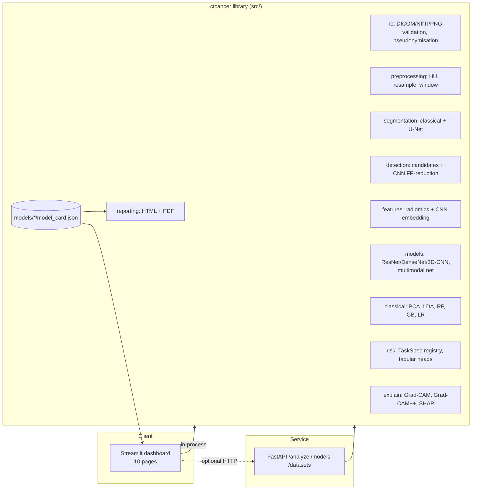
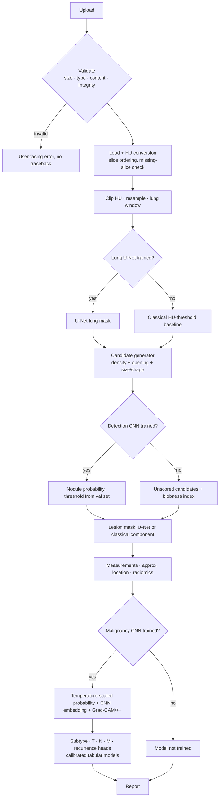
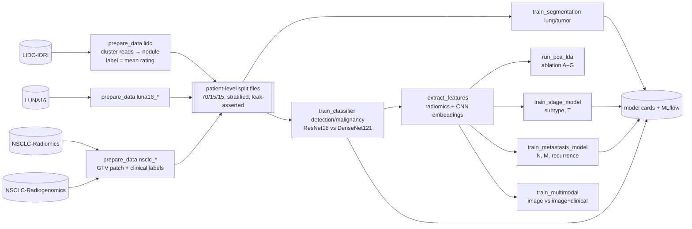

# AI-Assisted CT-Based Cancer Detection, Characterization, Staging and Metastatic Risk Prediction System

*Lung cancer, chest CT — an academic ML/DL capstone research prototype.*

> **Medical disclaimer.** This is an academic research prototype and clinical decision-support
> *demonstration*. It does **not** diagnose cancer, does **not** determine an official cancer
> stage and does **not** replace a radiologist or oncologist. Every output is a model-generated
> probability/estimate that requires expert validation. Not a medical device.

---

## Contents
1. [Overview](#1-overview) · 2. [Problem & motivation](#2-problem-statement-and-motivation) ·
3. [What is (and is not) supported by data](#3-what-is-and-is-not-supported-by-data) ·
4. [Architecture](#4-architecture) · 5. [Repository structure](#5-repository-structure) ·
6. [Installation](#6-installation) · 7. [Data preparation](#7-data-preparation) ·
8. [Training](#8-training) · 9. [Evaluation](#9-evaluation) · 10. [Inference & app](#10-inference-and-the-application) ·
11. [Deployment](#11-deployment) · 12. [Methods](#12-methods-in-detail) ·
13. [Research comparisons & ablation](#13-research-comparisons-and-ablation-study) ·
14. [Testing](#14-testing) · 15. [Privacy & security](#15-privacy-and-security) ·
16. [Limitations & ethics](#16-limitations-and-ethical-considerations) · 17. [Future work](#17-future-work) ·
18. [References](#18-references)

---

## 1. Overview

Upload a chest CT (DICOM series, NIfTI, MetaImage; PNG/JPEG for demonstration only) and the system runs:

```
CT → validation → HU conversion & resampling → lung segmentation → nodule candidates
   → CNN false-positive reduction → lesion segmentation → radiomic + deep features
   → malignancy-suspicion probability → subtype / T / N / M estimates (where labels exist)
   → Grad-CAM / Grad-CAM++ → structured HTML/PDF research report
```

The platform combines medical CT processing, 2-D/3-D U-Nets, transfer-learned CNN classifiers
(ResNet18 vs DenseNet121, optional 3-D CNN), radiomics, **PCA and LDA**, gradient boosting /
random forests, an image+clinical **multimodal** network, calibration, explainability, a
Streamlit research dashboard, a FastAPI inference service, MLflow tracking, tests and Docker.

**Honesty by construction.** Each pipeline stage reports *how* its output was produced:

| State | Meaning | Shown as |
|---|---|---|
| `evaluated` | trained, and tested once on held-out patients | probabilities + test metrics from the model card |
| `trained_unevaluated` | weights exist, no test evaluation recorded | flagged |
| `not_trained` | no model card | **"Model not trained"** — no numbers |
| `refused` | training refused: too few labels for a class | "Insufficient labels" |
| `unsupported` | no public dataset can supervise it | "…requires an appropriately labeled dataset." |

There are **no hard-coded metrics or example predictions anywhere** in the code, app or report.
Metrics appear only after you train on real data.

### Status of this repository

- ✅ All code paths implemented and integrated; 42 unit/integration tests pass.
- ✅ Every training script was executed end-to-end on a **synthetic software-test fixture**
  (`tests/integration/run_training_smoke.sh`) to verify mechanics. Those numbers are meaningless
  and are never written into `models/`.
- ⏳ **No model has been trained on real data in this repository.** The app therefore shows
  "Model not trained" until you download the datasets and run the training scripts (§7–8).

## 2. Problem statement and motivation

Lung cancer is the leading cause of cancer death worldwide; CT screening reduces mortality but
generates many indeterminate nodules. Radiologists must detect small nodules, judge malignancy
risk and — for confirmed cancers — reason about histology and spread, all from imaging. Research
systems that combine detection, segmentation, quantitative imaging features and calibrated risk
estimation can support (not replace) that work. Public data, however, only partly supports these
tasks; a scientifically defensible project must make that boundary explicit — which is the core
design principle here.

## 3. What is (and is not) supported by data

Full table, acquisition steps and leakage traps: **[`docs/DATASETS.md`](docs/DATASETS.md)**.

| Dataset | Task | Labels | Imaging | Patients | Limitations |
|---|---|---|---|---|---|
| LIDC-IDRI | nodule seg., malignancy suspicion, PCA/LDA | ≤4 readers, contours, malignancy 1–5 | CT DICOM | 1,010 | ratings ≠ pathology |
| LUNA16 | lung seg., detection | ≥3/4-reader nodules, candidates, lung masks | CT MHD | 888 scans | LIDC subset; algorithmic masks |
| NSCLC-Radiomics | tumour seg., subtype, T/N/(M) | GTV; clinical TNM; histology; age/sex | CT + RTSTRUCT/SEG | 422 | no benign; few M1; CC BY-NC |
| NSCLC-Radiogenomics | tumour seg., subtype, T/N, multimodal | pathological TNM, histology, smoking, recurrence | CT, PET/CT | 211 | small; surgical cohort |

**Architecture changes made to avoid unsupported claims** (relative to the original specification):

| Specification asked for | What was built instead | Why |
|---|---|---|
| "Cancer / malignancy classification" | *Malignancy-suspicion* probability calibrated to LIDC radiologist ratings | LIDC has no biopsy label for most nodules |
| Subtype incl. small-cell | Adenocarcinoma / squamous / other-NSCLC; SCLC reported unavailable | NSCLC cohorts contain no SCLC |
| Stage (I–IV) | Separate T, N, M category probabilities; no overall stage | stage needs full clinical work-up |
| Metastasis per organ | N0 vs N+ and M0 vs M1 heads (M refused if too few M1); organ sites marked unsupported | no per-organ labels exist |
| "Location: right upper lobe" | side + vertical third + central/peripheral | no lobe segmentation labels |
| Detection "probability" before training | geometric *blobness* index, explicitly not a probability | probability needs the trained FP-reduction CNN |

Subtype/T/N/M heads are trained on NSCLC primary tumours and therefore only meaningful if the
index lesion is a known primary NSCLC tumour — the app states this next to every estimate.

## 4. Architecture

### 4.1 System



### 4.2 Inference pipeline



### 4.3 Training & data flow



## 5. Repository structure

```
ct-cancer-ai/
├── app/                     Streamlit UI: Home.py + pages/1_Upload_CT … 9_Report, ui.py (theme, viewer)
├── api/main.py              FastAPI inference service
├── configs/                 default.yaml + profile_lite.yaml / profile_full.yaml
├── data/                    (git-ignored) raw/, processed/, splits/, features/ — see data/README.md
├── docs/DATASETS.md         dataset facts, label support, acquisition, leakage traps
├── evaluation/evaluate.py   summary of all model cards
├── inference/inference.py   CLI analysis + report
├── models/                  (empty) model weights + model_card.json per task
├── notebooks/               01_pipeline_walkthrough.ipynb
├── src/ctcancer/
│   ├── io/                  loaders (DICOM/NIfTI/PNG), validation, CTVolume, pseudonymisation
│   ├── preprocessing/       HU clipping, windowing, resampling, patches, 2.5-D inputs
│   ├── segmentation/        classical lung mask, left/right split
│   ├── detection/           candidate generation
│   ├── features/            radiomics (shape, first-order, GLCM), lesion measurements & location
│   ├── models/              UNet 2D/3D, ResNet/DenseNet/EfficientNet heads, 3D CNN, focal loss,
│   │                        temperature scaling, multimodal fusion net
│   ├── classical/           PCA/LDA pipelines, ablation configurations
│   ├── risk/                TaskSpec registry (wording + caveats), tabular trainer
│   ├── explain/             Grad-CAM, Grad-CAM++, feature importance, SHAP
│   ├── evaluation/          metrics (+bootstrap CIs, calibration), plots
│   ├── inference/           pipeline orchestration, model registry
│   ├── reporting/           HTML/PDF report
│   ├── data/                catalog, clinical parsers, LIDC/LUNA16/NSCLC builders, splits, datasets, augmentation
│   ├── tracking.py          MLflow or JSON-lines tracking
│   ├── training_utils.py    training loop (early stopping, staged unfreezing)
│   └── phantom.py           geometric software-test phantom (not patient data)
├── training/                prepare_data, preprocess_ct, train_segmentation, train_classifier,
│                            extract_features, run_pca_lda, train_stage_model,
│                            train_metastasis_model, train_multimodal
├── tests/                   42 tests + integration/run_training_smoke.sh
├── Dockerfile, docker-compose.yml, docker-entrypoint.sh, render.yaml, Makefile
└── requirements.txt, requirements-research.txt, environment.yml, pyproject.toml
```

## 6. Installation

Python 3.10–3.12 recommended (3.11 for PyRadiomics).

```bash
git clone <your-repo> ct-cancer-ai && cd ct-cancer-ai
python -m venv .venv && source .venv/bin/activate          # Windows: .venv\Scripts\activate
pip install torch torchvision --index-url https://download.pytorch.org/whl/cpu   # or the CUDA wheel
pip install -r requirements.txt            # app + core
pip install -r requirements-research.txt   # pylidc, mlflow, monai, pyradiomics, shap (training extras)
pip install -e .
pytest                                      # 42 tests, ~30 s on CPU
```

Conda: `conda env create -f environment.yml`.

## 7. Data preparation

1. Download the datasets and arrange them as in [`data/README.md`](data/README.md) (instructions in
   [`docs/DATASETS.md`](docs/DATASETS.md)). No synthetic substitute is ever generated; scripts stop
   with a clear message if data is missing.
2. Build caches and **patient-level** splits:

```bash
python training/prepare_data.py --dataset luna16_lung
python training/prepare_data.py --dataset luna16_candidates
python training/prepare_data.py --dataset lidc                     # add --limit 50 for a dry run
python training/prepare_data.py --dataset nsclc_radiomics
python training/prepare_data.py --dataset nsclc_radiogenomics
python training/preprocess_ct.py --input data/raw/NSCLC-Radiomics/LUNG1-001   # inspect one scan (NIfTI out)
```

Each split file (`data/splits/<dataset>.json`) stores patient IDs per split, counts, the seed and a
hash of the table (used as the *dataset version* in experiment tracking).

## 8. Training

All scripts take `--config`, `--profile lite|full` and dotted overrides `--set key=value`
(batch size, learning rate, epochs, architectures, image size, seed, paths …).

```bash
python training/train_segmentation.py --target lung
python training/train_segmentation.py --target tumor
python training/train_classifier.py --task nodule_detection
python training/train_classifier.py --task malignancy            # compares resnet18 vs densenet121
python training/extract_features.py --dataset lidc               # radiomics + CNN embeddings
python training/extract_features.py --dataset nsclc_radiomics
python training/extract_features.py --dataset nsclc_radiogenomics
python training/run_pca_lda.py                                   # representation study / ablation
python training/train_stage_model.py                             # subtype, T
python training/train_metastasis_model.py                        # N, M, distant recurrence
python training/train_multimodal.py                              # image vs image+clinical
python evaluation/evaluate.py                                    # summary table of all model cards
# or simply: make train-all
```

Experiment tracking: with `mlflow` installed runs go to `mlruns/` (`mlflow ui --backend-store-uri mlruns`);
otherwise to `mlruns/runs.jsonl`. Logged: hyper-parameters, per-epoch train/val loss and metric,
final test metrics, model version, dataset version (split hash), experiment name; best checkpoint saved.

### Lite vs full profile

| | Lite (laptop, CPU) | Full (GPU ≥12 GB) |
|---|---|---|
| Lung segmentation | 2-D U-Net, 192², base 8 | 3-D U-Net (config) |
| Lesion classifier | 2.5-D ResNet18 / DenseNet121, 48–64 vox patches | + 3-D CNN, 64³ |
| Spacing | 1.5 × 1 × 1 mm | 1 mm isotropic |
| Epochs | 15 | 100 |
| Trade-off | fast, transfer learning works with little data; loses some through-plane context | captures 3-D shape (spiculation, vessel attachment) but needs more data/compute and overfits small cohorts |

## 9. Evaluation

Each metric is computed **once** on the held-out test patients, with patient-bootstrap 95 % CIs:

- Classification: accuracy, precision, recall/sensitivity, specificity, F1, balanced accuracy,
  ROC-AUC, PR-AUC, confusion matrix, Brier score, expected calibration error, reliability curves.
  The operating threshold (Youden J) and the temperature are fitted on the **validation** set.
- Segmentation: Dice, IoU, sensitivity, specificity, HD95.
- Regression (volume/diameter, extension): MAE, RMSE, R² (`evaluation.metrics.regression_metrics`).
- Multiclass: macro ROC-AUC (OvR), macro F1, per-class report.

Figures → `outputs/figures/` (ROC/PR/calibration, confusion matrices, training curves, PCA/LDA
projections, feature importance, model comparison). The *Model Performance* page renders them.

## 10. Inference and the application

```bash
streamlit run app/Home.py                         # dashboard at http://localhost:8501
uvicorn api.main:app --port 8000                  # API docs at http://localhost:8000/docs
python inference/inference.py --input scan.nii.gz --age 67 --sex male   # CLI + report
```

Pages: **Home** (pipeline, module status, datasets, privacy) · **Upload CT** (validation, optional
age/sex, phantom demo) · **CT Viewer** (axial/coronal/sagittal, slice slider, zoom/pan, window/level
presets + sliders, lung/lesion/Grad-CAM overlays, 3-D mesh rendering) · **Segmentation** ·
**Cancer Analysis** (dashboard cards, lesion table, probability bars, gauges) · **Staging / Risk** ·
**Metastasis** · **Explainability** (Grad-CAM, Grad-CAM++, feature importance, interactive PCA/LDA) ·
**Model Performance** · **Report** (HTML/PDF/JSON download).

The *Synthetic software-test phantom* option lets you click through the full UI before any data is
downloaded. It is a geometric object, labelled as such everywhere, and model outputs on it are meaningless.

Example workflow: train → `streamlit run app/Home.py` → Upload CT (zip of a DICOM series) →
check warnings (missing slices, non-axial, unusual HU) → CT Viewer → Cancer Analysis → Explainability → Report.

## 11. Deployment

| Target | How | Notes |
|---|---|---|
| Local | `make install && make app` | everything in-process |
| Docker | `docker build -t ct-cancer-ai . && docker run -p 8501:8501 -v $PWD/models:/app/models ct-cancer-ai` | CPU image; `… ct-cancer-ai api` for the API |
| Compose (split) | `docker compose up` | `api` and `ui` services; set `CTC_API_URL` to route uploads through the API |
| Streamlit Cloud | point it at `app/Home.py`; use `requirements.txt` | ~1 GB RAM: lite models only; weights via Git LFS/release; **do not upload real patient scans to a public app** |
| Render | `render.yaml` blueprint (UI + API) | free tier 512 MB; use paid tier for 3-D |

Large models can be served from a separate GPU host running `api/main.py`; the UI then only needs
`CTC_API_URL` (results-only mode; the CT viewer needs in-process mode because volumes are not sent over HTTP).

## 12. Methods in detail

**Preprocessing.** DICOM slices are ordered by `ImagePositionPatient` projected on the slice normal
(not by file name/`InstanceNumber`), duplicates removed, gaps detected; HU = stored × slope +
intercept with padding/out-of-FOV values set to −1024. Volumes are clipped to [−1200, 600] HU,
resampled to target spacing (linear for images, nearest for masks), lung-windowed (L −600 / W 1500)
to [0, 1]. Optional mild median/Gaussian denoising (off by default: it erases small nodules and
alters texture features). *Why not RGB:* converting CT to 8-bit RGB keeps one window and destroys
the HU calibration; for ImageNet CNNs the three channels carry **three adjacent slices** (2.5-D) instead of copies.

**Lung segmentation.** Classical baseline: HU < −320, remove border-connected air, keep the two
largest 3-D components, closing + hole filling (re-includes vessels/juxtapleural nodules),
left/right split in LPS coordinates. Learned: U-Net (instance norm, Dice + CE loss) on LUNA16 masks.

**Detection.** Stage 1: dense voxels inside the (dilated) lung, ~3 mm morphological opening removes
thin vessels, size 3–40 mm, then morphological reconstruction restores the lesion border. Stage 2:
CNN false-positive reduction on 48 mm patches with LUNA16 labels. On the test phantom the generator
recovers a 14 mm sphere with Dice 0.95 and diameter error < 1 mm.

**Lesion segmentation & features.** U-Net on 96×96 1-mm slices from LIDC consensus masks and NSCLC
GTVs. Features: volume, surface area (marching cubes), sphericity, compactness, elongation, flatness,
max 3-D and max axial (RECIST-like) Feret diameters (exact via convex hull), first-order HU statistics
(incl. solid fraction), GLCM texture; PyRadiomics optional (`--pyradiomics`).

**Classification & transfer learning.** ImageNet ResNet18/DenseNet121: phase 1 trains only the new
head (backbone frozen, `freeze_backbone_epochs`); phase 2 unfreezes the last stage (ResNet `layer4`,
DenseNet `denseblock4`+`norm5`) at 0.1× LR; earlier stages stay frozen. Rationale: ~10³ labelled
lesions are too few to train deep CNNs from scratch, and early ImageNet filters (edges, blobs,
textures) transfer to CT patches; the domain gap is handled by fine-tuning the high-level stage.
Calibration: temperature scaling on the validation set.

**Class imbalance.** Patient-level stratified splits, class-weighted focal loss (γ = 2) for CNNs,
`class_weight="balanced"` for tabular models, subsampling of easy negatives for detection, PR-AUC
reported alongside ROC-AUC. No SMOTE on images.

**Augmentation.** ±15° in-plane rotation, ±10 % scaling, ±3-voxel shifts, HU-scale/offset jitter,
low-amplitude noise; L-R/A-P flips for lesion patches only. No cranio-caudal flips, no 90° rotations,
no elastic deformation (it alters nodule shape, itself a malignancy cue).

**Data leakage prevention.** All splits are by patient (70/15/15, stratified on a per-patient label,
asserted disjoint); multiple LIDC reads are clustered into one nodule; small-cohort tasks use a
15 % patient hold-out + **stratified grouped** 5-fold CV; imputation/scaling/PCA/LDA are fitted in-fold;
clinical imputation uses training patients only; thresholds and temperatures come from validation data.

**PCA.** Unsupervised; keeps components explaining 95 % of variance. Reduces noise/collinearity
in ~30 radiomic or 512–1024 CNN features. **LDA.** Supervised; at most K−1 discriminant axes
(one axis for benign vs suspicious) maximising between- vs within-class scatter, with shrinkage.
**Why they differ:** PCA's top directions follow the largest variance — often lesion size,
scanner or kernel — regardless of label, whereas LDA's axis is chosen *because* it separates the
classes. With many more CNN features than patients, LDA's within-class covariance is singular, so
the pipeline is CNN → PCA → LDA → classifier. Projections are fitted on development patients and
plotted for test patients (Explainability page).

**Multimodal model.** Image branch: frozen CNN embedding → dense; clinical branch: only variables
present in the cohorts (age, sex, smoking status, pack-years) with missing-indicators → dense;
late fusion → one head per task with enough labels (subtype, N), masked losses for missing labels.

**Staging / metastasis heads.** For each task the trainer compares feature sets (radiomics, CNN,
radiomics+CNN, ±clinical) × reduction (none/PCA/LDA/PCA+LDA) × classifier (logistic, random forest,
gradient boosting) with grouped CV, refits the best on development patients with sigmoid calibration,
and tests once. Tasks with any class below `risk.min_positive_labels` (default 15) are **refused**.
Risk bands Low/Moderate/High use display cut-offs (33 %/66 %) that are explicitly *not* clinical thresholds.

**Explainability.** Grad-CAM and Grad-CAM++ on the last convolutional stage (2-D or 3-D),
impurity/coefficient importance for unprojected tabular models, optional SHAP. Always captioned
"regions contributing most strongly to this model prediction"; never presented as proof of location.

## 13. Research comparisons and ablation study

Produced automatically once data is available:

| Comparison | Where |
|---|---|
| ResNet18 vs DenseNet121 (vs 3-D CNN in full profile) | `train_classifier.py` → `architecture_comparison.csv`, comparison chart |
| CNN vs classical ML | CNN test AUC vs `run_pca_lda.py` radiomics models |
| Radiomics vs deep features | ablation A vs B |
| PCA vs no PCA, LDA vs no LDA | A vs C, B vs B′ vs D, A vs A′ |
| Single-modality vs multimodal | `train_multimodal.py`; E/F/H arms in staging tasks |
| 2-D vs 3-D | lite vs full profile |

Ablation arms: **A** radiomics · **A′** radiomics+LDA · **B** CNN · **B′** CNN+PCA · **C** radiomics+PCA ·
**D** CNN+PCA+LDA · **E** CNN+clinical · **F** CNN+radiomics+clinical · **G** radiomics+CNN+PCA ·
**H** radiomics+clinical. Ranking uses CV AUC on development patients; all test AUCs are reported with CIs
(selection on test data is avoided). Interpret differences whose CIs overlap as inconclusive.

## 14. Testing

```bash
pytest                                     # unit + integration (42 tests)
bash tests/integration/run_training_smoke.sh   # every training script on a synthetic fixture (~5 min CPU)
```

Covered: DICOM loading (HU conversion with slope/intercept, ordering against misleading
`InstanceNumber`, missing slices, padding, corrupted files, PHI not retained), NIfTI, PNG demo mode,
zip-slip and size limits, preprocessing, lung masking, candidate detection accuracy, shape-feature
accuracy on spheres, metrics with known values, patient-level splitting and leakage assertion, train-only
imputation, clinical CSV parsing (unknown stages stay missing), U-Net/backbones/3-D CNN, Grad-CAM/++,
focal loss, temperature scaling, multimodal net, registry states, pipeline honesty without models,
graceful errors, report content, API endpoints.

## 15. Privacy and security

- Processing is local; no data is sent to external APIs. Uploads go to a private temp dir and are deleted
  after processing (`app.keep_uploads: false`).
- DICOM identifiers are never stored or returned; scans get a one-way pseudonymous ID; a log filter
  redacts patient name/ID/birth date if they ever reach a log message.
- Uploads are validated by content (magic bytes), extension allow-list and size limit; archives are
  checked for path traversal and decompression bombs; the API streams uploads with a hard cap.
- No credentials or keys in code; CORS restricted by `CTC_CORS_ORIGINS`; the container runs as non-root.
- Do not deploy a public instance for real patient data without institutional approval.

## 16. Limitations and ethical considerations

- Not clinically validated; public, mostly North-American/European, older-scanner cohorts → domain shift.
- Proxy labels (radiologist suspicion), mixed clinical/pathological staging, small cohorts, selection
  bias (Radiogenomics is surgical), class imbalance (rare M1).
- Calibrated probabilities are calibrated *to the training population*; prevalence differs in screening.
- Automation bias: estimates are paired with caveats and status badges to discourage over-reliance.
- Licences: NSCLC-Radiomics is non-commercial (CC BY-NC); cite every dataset as required by TCIA.

## 17. Future work

Lobe and lymph-node segmentation (enables lobar location and direct N assessment); nnU-Net / MONAI
bundles; 3-D detection (e.g. RetinaNet); external validation (MSD, NLST subsets with pathology);
survival models (Lung1 survival data); PET fusion (Radiogenomics); uncertainty (MC-dropout, deep
ensembles, conformal prediction); DICOM-SEG/SR export; organ-specific metastasis once labelled data exist.

## 18. References

1. Armato SG III et al. *The LIDC/IDRI database.* Med Phys 2011;38:915–931. (TCIA: LIDC-IDRI, CC BY 3.0)
2. Setio AAA et al. *Validation, comparison, and combination of algorithms for automatic detection of pulmonary nodules in CT: the LUNA16 challenge.* Med Image Anal 2017;42:1–13.
3. Aerts HJWL et al. *Decoding tumour phenotype by noninvasive imaging using a quantitative radiomics approach.* Nat Commun 2014;5:4006. (TCIA: NSCLC-Radiomics, CC BY-NC 3.0)
4. Bakr S et al. *A radiogenomic dataset of non-small cell lung cancer.* Sci Data 2018;5:180202. (TCIA: NSCLC-Radiogenomics)
5. Clark K et al. *The Cancer Imaging Archive (TCIA).* J Digit Imaging 2013;26:1045–1057.
6. Ronneberger O et al. *U-Net.* MICCAI 2015. · Çiçek Ö et al. *3D U-Net.* MICCAI 2016. · Isensee F et al. *nnU-Net.* Nat Methods 2021.
7. He K et al. *Deep residual learning.* CVPR 2016. · Huang G et al. *Densely connected CNNs.* CVPR 2017.
8. Lin T-Y et al. *Focal loss.* ICCV 2017. · Guo C et al. *On calibration of modern neural networks.* ICML 2017.
9. Selvaraju RR et al. *Grad-CAM.* ICCV 2017. · Chattopadhay A et al. *Grad-CAM++.* WACV 2018.
10. van Griethuysen JJM et al. *Computational radiomics system (PyRadiomics).* Cancer Res 2017. · Zwanenburg A et al. *IBSI.* Radiology 2020.
11. Antonelli M et al. *The Medical Segmentation Decathlon.* Nat Commun 2022.

*Code licence: MIT. Datasets retain their own licences and citation requirements.*
